<div align="center">

# 🛰️ SAREO-Kumbh

### GeoFusion-QGIS: Monitoring the Maha Kumbh 2025 Tent City at Prayagraj Using Multi-Sensor SAR and Optical Imagery in QGIS

[](https://qgis.org)
[](https://step.esa.int)
[](https://www.orfeo-toolbox.org)
[](https://www.python.org)
[](https://gdal.org)
[](https://sentinels.copernicus.eu/web/sentinel/missions/sentinel-1)
[](https://sentinels.copernicus.eu/web/sentinel/missions/sentinel-2)
[](LICENSE)

**A temporary city of about 11 km² rose on the Ganga–Yamuna floodplain and vanished within months.<br>
This project tracks its life cycle with free radar and optical satellite data, entirely in open-source GIS.**

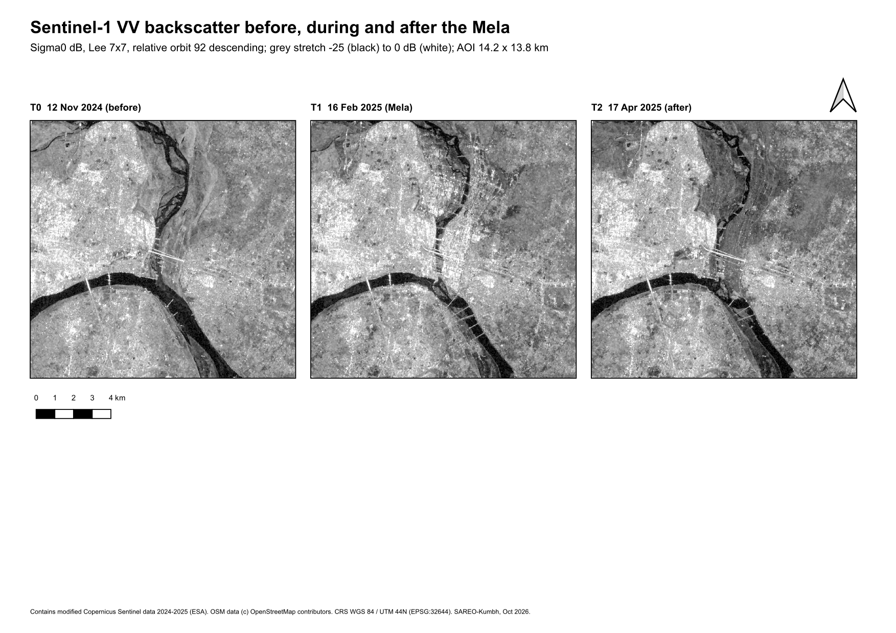

<sub>Sentinel-1 VV σ⁰: before (Nov 2024) · peak (Feb 2025) · after (Apr 2025). The bright block is the tent city.</sub>

</div>

---

## 📑 Contents

- [Highlights](#-highlights)
- [Study area and data](#-study-area-and-data)
- [Workflow](#-workflow)
- [Results](#-results)
- [Map gallery](#-map-gallery)
- [Classical vs AI methods](#-classical-vs-ai-methods)
- [Assessment brief coverage](#-assessment-brief-coverage)
- [Repository structure](#-repository-structure)
- [Getting started](#-getting-started)
- [Reproducing the pipeline](#-reproducing-the-pipeline)
- [Phase-by-phase details](#-phase-by-phase-details)
- [Limitations](#-limitations)
- [Future work](#-future-work)
- [FAQ](#-faq)
- [References](#-references)
- [License and author](#-license-and-author)

---

## ✨ Highlights

| | |
|---|---|
| 🎯 **Fusion pays off** | Random Forest overall accuracy rises from **0.594** (SAR only) and **0.784** (optical only) to **0.867** (fused + multi-temporal, κ = 0.824). |
| ⏱️ **Time is the key feature** | Tents and permanent buildings are inseparable on a single SAR date (JM 0.49) but clearly separable across dates (JM 1.74). |
| 📈 **Tent-city life cycle** | 0 → 10.95 → 10.25 → 8.71 → 0.26 km² across Nov 2024, Jan 2025, early Feb, mid Feb and Apr 2025. |
| 🔬 **25 speckle filters benchmarked** | Lee 7×7 chosen: ENL 5.17 → 22.28 with an edge preservation index of 0.85. |
| 🧩 **Lossless fusion** | An 11-band SAR + EO stack, verified bit-identical on round trip, plus PCA, IHS, Brovey and HPF with CC, ERGAS, SAM and sCC scores. |
| 🤖 **AI compared fairly** | SAR2SAR despeckling, OmniCloudMask and Segment Anything, each run against its classical counterpart. |
| ♻️ **Fully reproducible** | Every step is scripted and logged. The QGIS project uses relative paths and passed a reopen test from a different folder (47/47 layers valid). |

---

## 🌍 Study area and data

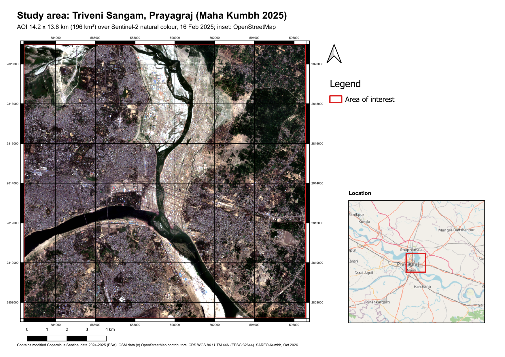

**Area of interest:** Sangam, Prayagraj, Uttar Pradesh, India
- Extent: 582 400–596 600 E, 2 807 200–2 821 000 N
- CRS: **WGS 84 / UTM 44N (EPSG:32644)**
- Grid: **10 m**, 1420 × 1380 pixels (14.2 × 13.8 km)

**Why here?** The Maha Kumbh 2025 (13 Jan – 26 Feb 2025) built a city of tents, roads and pontoon bridges on seasonal sand bars right next to water. It appeared and disappeared within a few months, which makes it an ideal test of multi-sensor change monitoring.

<br clear="right"/>

<details>
<summary><b>📅 Image dates (click to expand)</b></summary>

| Epoch | Sentinel-1 (S1A, orbit 92, descending, IW GRD) | Sentinel-2 (L2A, tile 44RNP) | Meaning |
|---|---|---|---|
| **T0** | 2024-11-12 | 2024-11-13 | Before construction |
| T1a | 2025-01-23 | — | Festival under way |
| T1b | 2025-02-04 | — | Festival under way |
| **T1** | 2025-02-16 | 2025-02-16 | Peak — **same-day SAR + optical pair** |
| **T2** | 2025-04-17 | 2025-04-17 | After removal |
| Monsoon test | — | 2025-08-15, 2025-09-24 | Cloud-mask comparison only |

Product IDs are listed in [`09_docs/download_manifest.csv`](09_docs/download_manifest.csv), and every download is recorded in [`09_docs/download_log.csv`](09_docs/download_log.csv).

</details>

<details>
<summary><b>🗂️ Open data sources used</b></summary>

| Source | Data | Use |
|---|---|---|
| [Copernicus Data Space Ecosystem](https://dataspace.copernicus.eu) | Sentinel-1 GRD, Sentinel-2 L2A | Main imagery |
| Copernicus DEM GLO-30 | 30 m DEM | SAR terrain correction (auto-downloaded by SNAP) |
| [OpenStreetMap](https://www.openstreetmap.org) (Overpass API) | Bridges, roads, water, buildings | Absolute location check, reference layers |
| ISRO / NRSC EOS-04 (public release) | Radar images of the Mela | Qualitative comparison |

</details>

---

## 🔄 Workflow

<p align="center">
  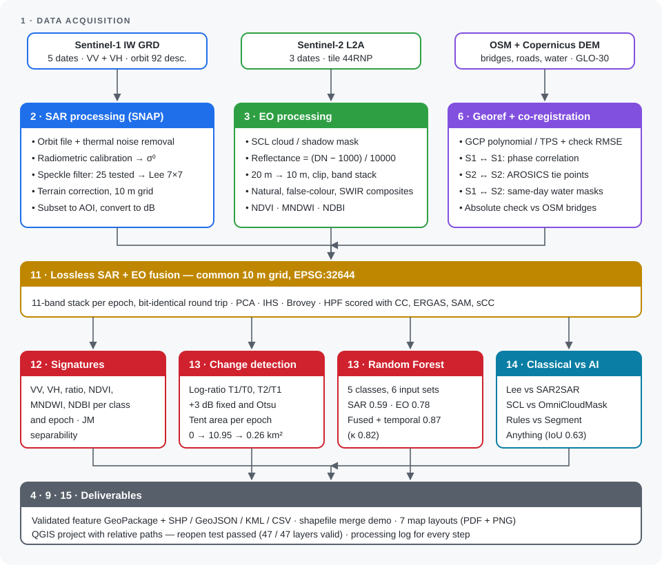
</p>

<sub>Numbers in the boxes refer to items of the assessment brief.</sub>

<details>
<summary><b>Interactive version (Mermaid, zoom and pan on github.com)</b></summary>

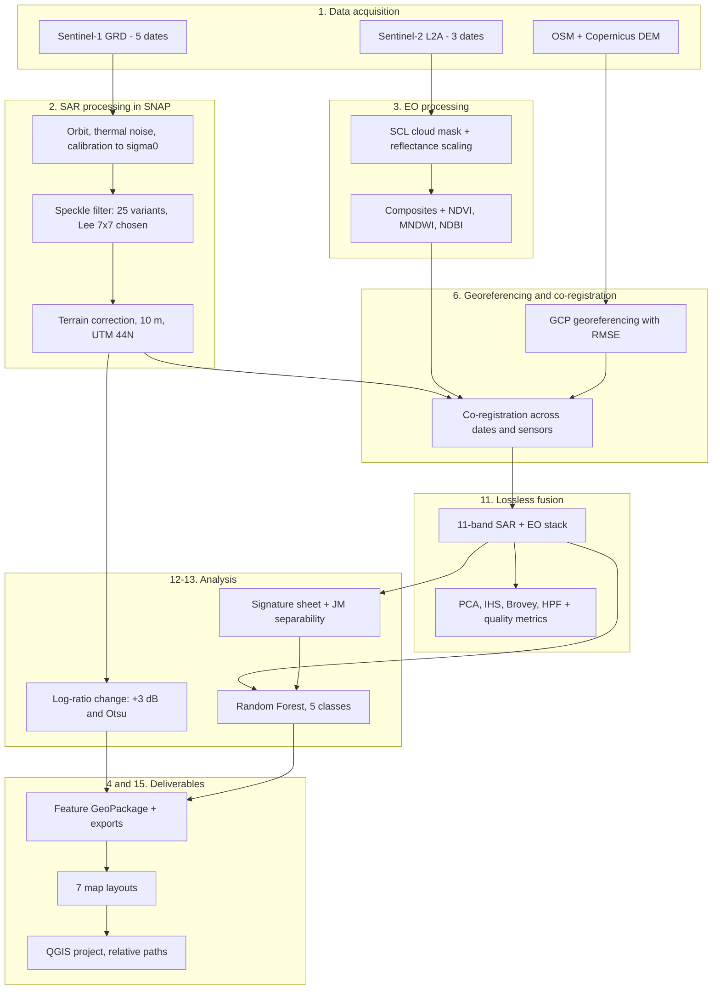

</details>

---

## 📊 Results

### Tent-city area over time

| Date | 2024-11-12 | 2025-01-23 | 2025-02-04 | 2025-02-16 | 2025-04-17 |
|---|---|---|---|---|---|
| **Fixed +3 dB** (km²) | 0.00 | **10.95** | 10.25 | 8.71 | 0.26 |
| **Otsu +1.97 dB** (km²) | 0.00 | 15.12 | 13.72 | 11.53 | 0.63 |

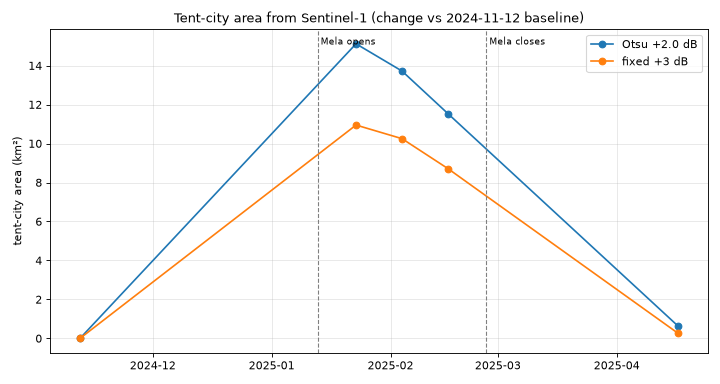

### Classification accuracy (Random Forest, independent validation polygons)

| Input set | Features | Overall accuracy | κ | Macro F1 | Tent PA / UA |
|---|---|---|---|---|---|
| SAR only | 3 | 0.594 | 0.490 | 0.549 | 0.36 / 0.71 |
| EO only | 8 | 0.784 | 0.714 | 0.742 | 0.73 / 0.88 |
| SAR multi-temporal | 8 | 0.792 | 0.724 | 0.764 | 0.82 / 0.86 |
| Fused (SAR + EO) | 11 | 0.838 | 0.785 | 0.802 | 0.80 / 0.96 |
| **Fused + temporal** | **17** | **0.867** | **0.824** | **0.833** | **0.87 / 0.97** |
| Fused + temporal + change rule | 17 | 0.859 | 0.814 | 0.827 | 0.84 / 0.98 |

<details>
<summary><b>🔬 Speckle filter benchmark — top 8 of 25</b></summary>

Scored on the T1 scene using 25 homogeneous land blocks, 10 water blocks, 97 619 edge pixels and 6 231 point targets. Lower score is better.

| Rank | Filter | VV ENL | VV EPI | Point-target preservation | Mean ratio | Runtime (s) | Score |
|---|---|---|---|---|---|---|---|
| — | *Unfiltered* | 5.17 | 1.00 | 1.00 | 1.00 | — | — |
| **1** | **Lee 7×7** | **22.28** | 0.85 | 0.83 | 1.00 | 118 | **25.0** |
| 2 | Gamma-MAP 7×7 | 22.06 | 0.99 | 1.00 | 0.98 | 117 | 29.5 |
| 3 | SAR2SAR (deep learning) | 25.99 | 0.93 | 0.94 | 0.97 | 371 | 31.0 |
| 4 | Frost 7×7 | 23.64 | 0.84 | 0.70 | 1.00 | 90 | 32.0 |
| 5 | Gamma-MAP 5×5 | 15.10 | 0.97 | 1.00 | 0.98 | 143 | 35.5 |
| 6 | Kuan (OTB) 7×7 | 26.35 | 0.70 | 0.72 | 1.00 | 312 | 38.0 |
| 7 | Lee Sigma 7×7 | 17.15 | 0.87 | 0.75 | 0.98 | 122 | 39.0 |
| 8 | Multi-temporal Quegan | 9.81 | 0.96 | 1.01 | 0.99 | 1 | 39.0 |

Full table: [`09_docs/filter_comparison.md`](09_docs/filter_comparison.md) · write-up: [`06_Speckle_Filter_Evaluation.md`](09_docs/06_Speckle_Filter_Evaluation.md)

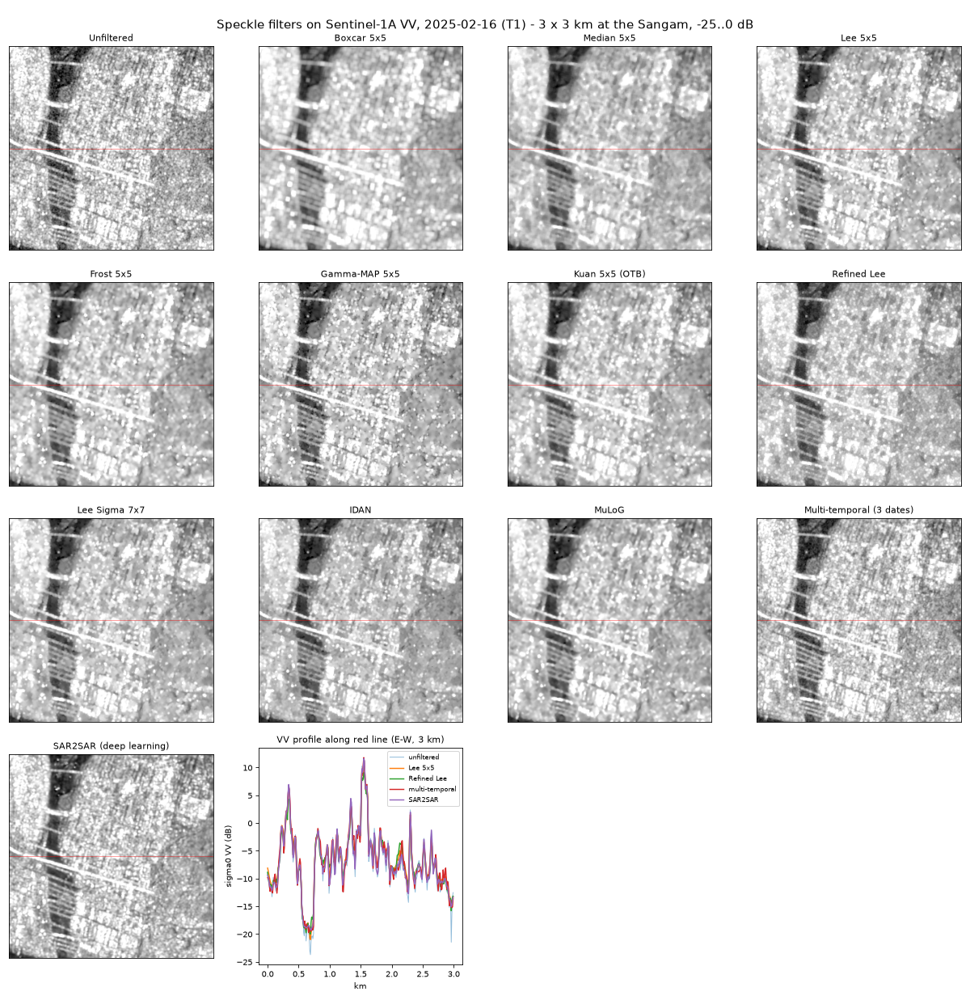

</details>

<details>
<summary><b>📐 Georeferencing and co-registration accuracy</b></summary>

**GCP georeferencing** (15 GCPs + 10 independent check points)

| Transform | GCP RMSE (m) | Check-point RMSE (m) |
|---|---|---|
| Polynomial 1 (affine) | 7.93 | 10.57 |
| **Polynomial 2** | 4.11 | **5.09** |
| Thin plate spline | 0.00 | 7.09 *(overfits)* |

**Co-registration**

| Pair | Method | Result |
|---|---|---|
| S1 date ↔ S1 date | Phase correlation | ≤ 0.05 px |
| S2 T0 / T2 → S2 T1 | AROSICS (≈ 360–400 valid tie points) | RMSE 2.6–3.3 m |
| S1 ↔ S2 (same day) | Water-mask matching | ≈ 2 m, IoU 0.62 |
| S1 ↔ S2 | AROSICS | 0 valid tie points (SAR and optical texture differ) |

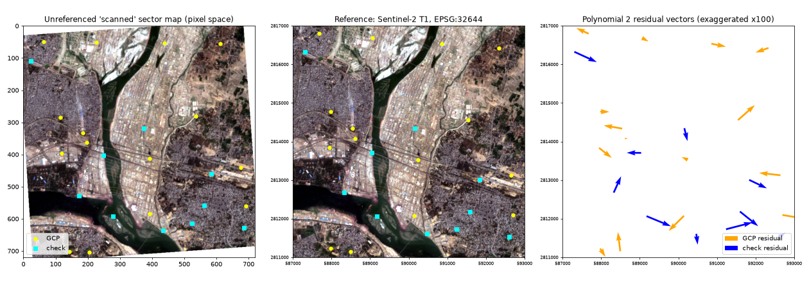

</details>

<details>
<summary><b>🧩 Fusion quality (T1, against the original Sentinel-2)</b></summary>

| Product | Mean CC ↑ | ERGAS ↓ | SAM (°) ↓ | sCC with SAR ↑ | Comment |
|---|---|---|---|---|---|
| **Stack (11 bands)** | 1.000 | 0 | 0 | — | **Lossless**, bit-identical round trip |
| HPF | **0.895** | **24.55** | 3.81 | 0.831 | Best spectral fidelity |
| PCA | 0.287 | 60.91 | 13.18 | 0.633 | PC1 holds 79.1 % of the variance |
| IHS | 0.114 | 76.50 | 13.65 | **0.847** | Most SAR structure, strongest colour shift |
| Brovey | 0.073 | 75.44 | 0.00\* | 0.226 | \*SAM is 0 by construction |

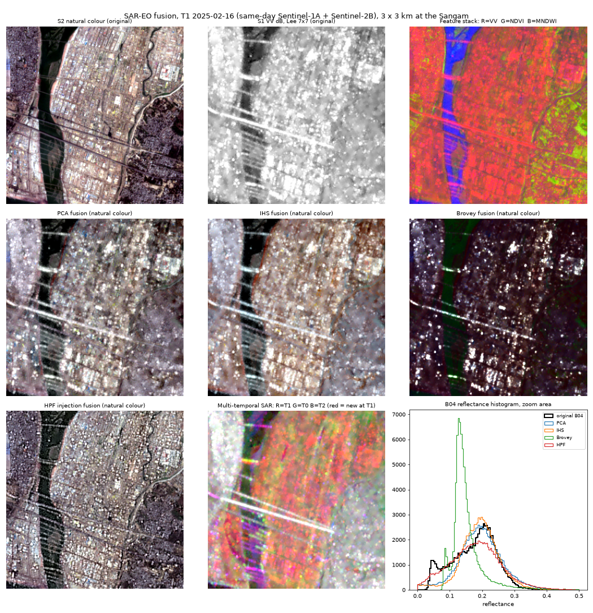

</details>

<details>
<summary><b>🧾 Signature reference sheet and class separability (Jeffries–Matusita, 0–2)</b></summary>

| Class pair | SAR T1 | SAR multi-temporal | EO T1 | **Fused T1** |
|---|---|---|---|---|
| water vs tent_block | 1.60 | 1.63 | 1.93 | **1.98** |
| water vs sand | 0.31 | 0.63 | 1.75 | **1.78** |
| tent_block vs sand | 0.93 | 1.08 | 1.41 | **1.70** |
| tent_block vs built_up | **0.49** | **1.74** | 1.77 | 1.81 |
| tent_block vs vegetation | 0.99 | 1.22 | 1.98 | 1.99 |
| sand vs built_up | 1.52 | 1.79 | 1.84 | 1.99 |

| Target | VV appearance | Mechanism |
|---|---|---|
| ⛺ Tents | Bright (+3 dB or more) | Double bounce between walls and flat ground; metal frames |
| 🏖️ Sand | Dark to medium | Smooth surface reflects energy away (near-specular) |
| 🌊 Water | Very dark | Mirror-like reflection |
| 🌉 Pontoon bridges | Very bright lines | Metal pontoons + water make a strong dihedral reflector |
| 🌾 Vegetation | Medium, high VH | Volume scattering depolarises the signal |
| 🏢 Buildings | Bright | Double bounce — like tents, but bright on every date |

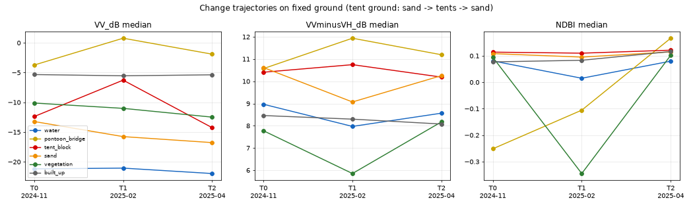

Full sheet: [`12_Signature_Reference_Sheet.md`](09_docs/12_Signature_Reference_Sheet.md)

</details>

---

## 🖼️ Map gallery

<table>
<tr>
<td width="50%">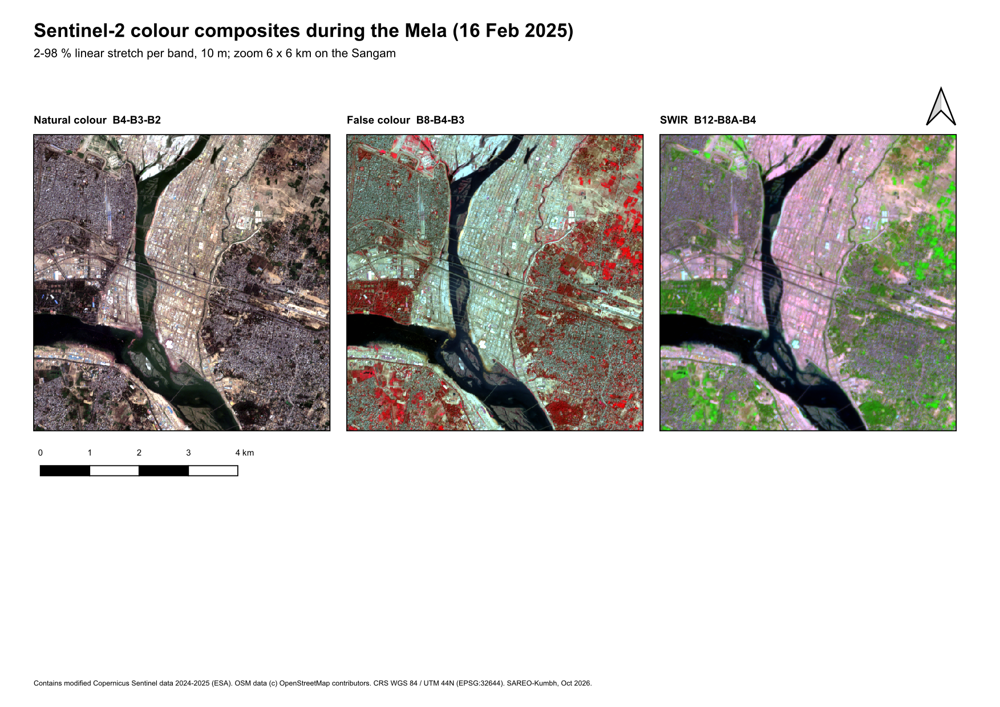<br/><sub><b>03</b> Sentinel-2 composites at T1</sub></td>
<td width="50%">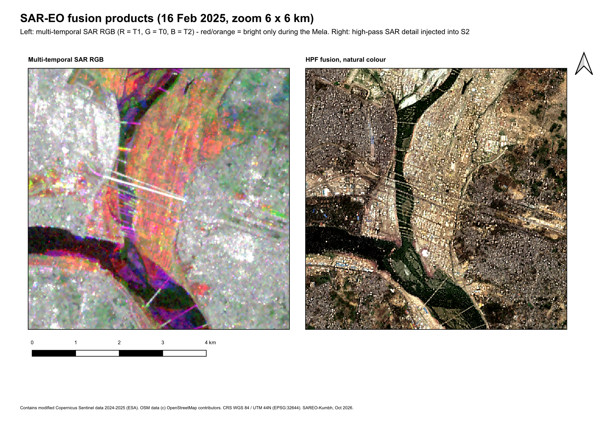<br/><sub><b>04</b> SAR–EO fusion products</sub></td>
</tr>
<tr>
<td>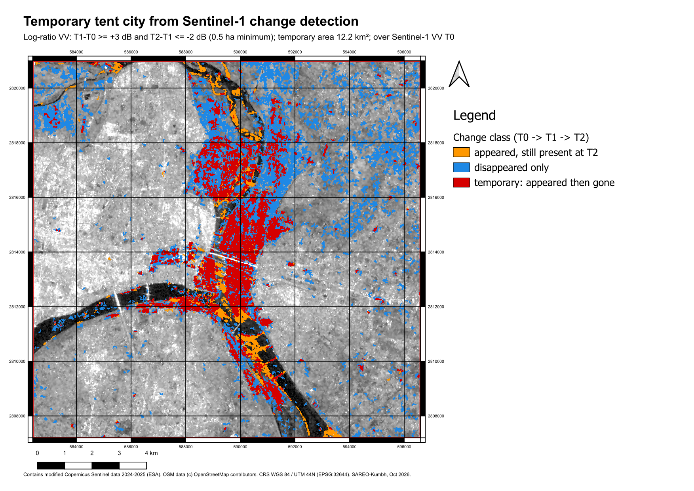<br/><sub><b>05</b> Log-ratio change map</sub></td>
<td>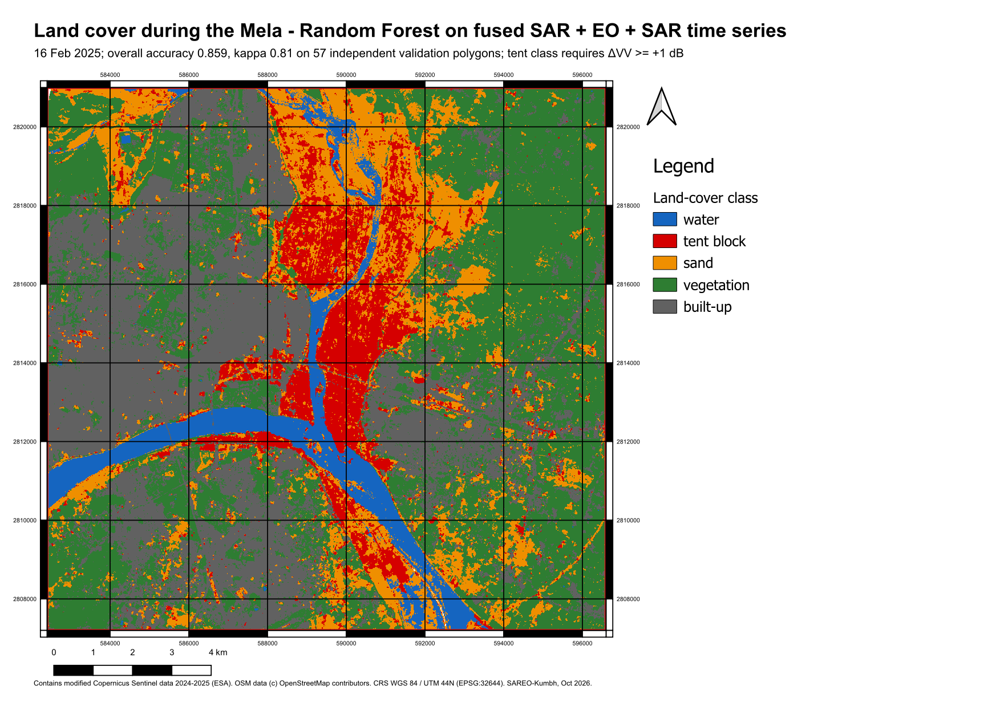<br/><sub><b>06</b> Random Forest classification</sub></td>
</tr>
<tr>
<td>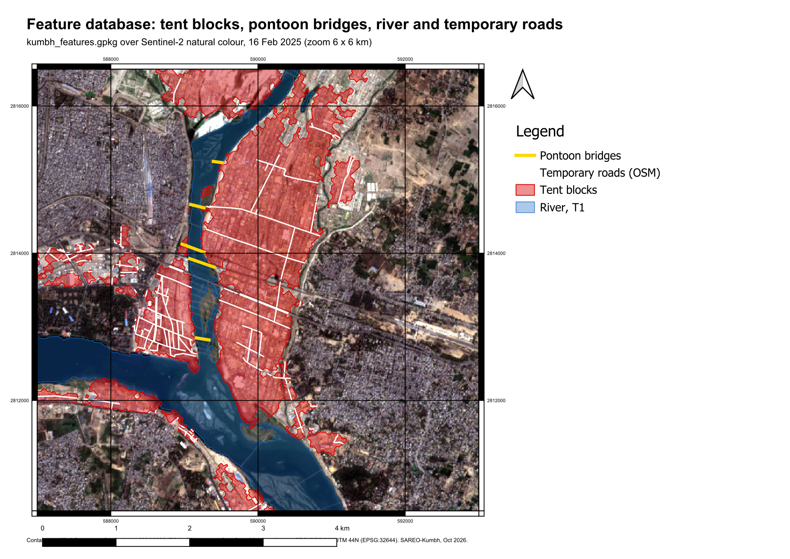<br/><sub><b>07</b> Vector feature database</sub></td>
<td>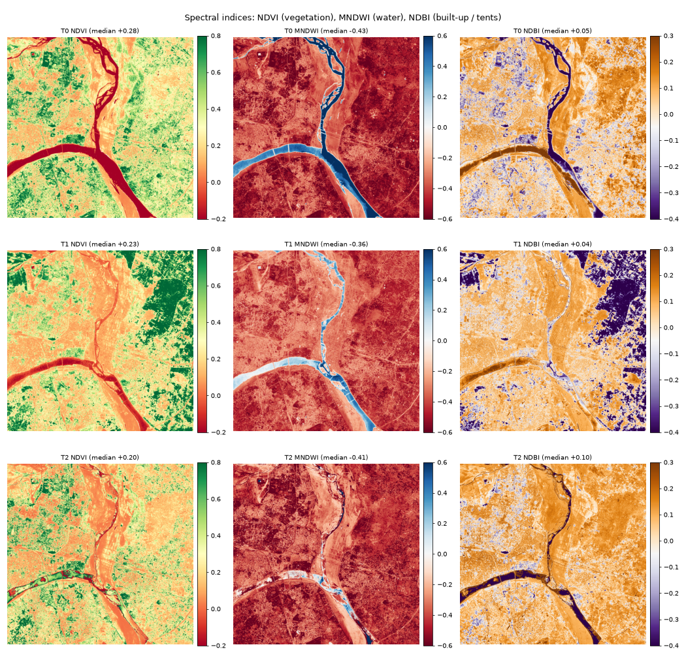<br/><sub>Spectral indices (NDVI, MNDWI, NDBI)</sub></td>
</tr>
</table>

High-resolution PDF versions of all 7 layouts are in [`08_layouts/`](08_layouts).

---

## 🤖 Classical vs AI methods

| Task | Classical | AI | Outcome |
|---|---|---|---|
| **Despeckling** | Lee 7×7 (SNAP) | SAR2SAR ([deepdespeckling](https://github.com/hi-paris/deepdespeckling)) | SAR2SAR keeps more VV detail (EPI 0.93) but runs 3× slower and smooths water poorly. **Lee kept** for robustness and explainability. |
| **Cloud masking** | Sentinel-2 SCL | [OmniCloudMask](https://omnicloudmask.readthedocs.io) | On monsoon scenes the two agree on 82–83 % of pixels (κ 0.62–0.66). Visual checks favour OmniCloudMask, which runs in 7–8 s per scene. |
| **Digitising tents** | Rule-based SAR + EO extraction | Segment Anything (ViT-B), point prompts | Mean IoU 0.63 against the rule-based result (0.41–0.73 per tile), about 7 s per 4 km² tile. Useful as a labelling aid. |

<details>
<summary><b>See the AI comparison figures</b></summary>

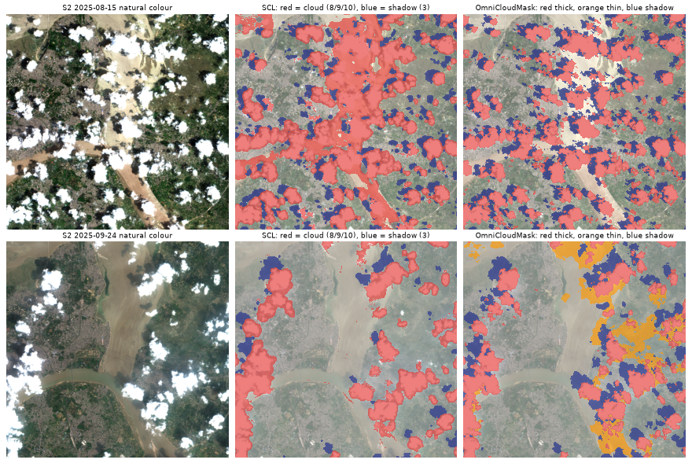
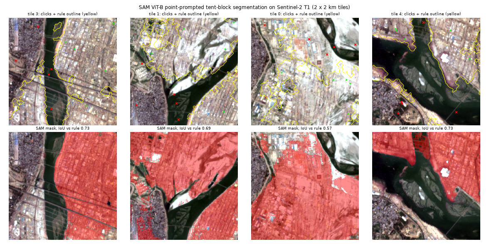

</details>

---

## ✅ Assessment brief coverage

| # | Brief item | Where | Status |
|---|---|---|---|
| 1 | Acquire imagery | `10_scripts/search_scenes.py`, `download_cdse.py` · [`04_Data_Selection.md`](09_docs/04_Data_Selection.md) | ✅ |
| 2.1 | SAR import and verification | `run_s1_preproc.ps1`, `check_s1_outputs.py` · [`05_SAR_Preprocessing.md`](09_docs/05_SAR_Preprocessing.md) | ✅ |
| 2.2 | SAR image characteristics | `s1_characteristics.py` | ✅ |
| 2.3 / 10 | Speckle filter evaluation and demonstrations | `run_filters.ps1`, `filter_metrics.py` · [`06_…`](09_docs/06_Speckle_Filter_Evaluation.md) | ✅ |
| 3 | EO preprocessing and enhancement | `s2_preprocess.py`, `s2_enhance.py` · [`07_EO_Processing.md`](09_docs/07_EO_Processing.md) | ✅ |
| 4.1–4.6 | Attributes, validation, CRS, naming, provenance, exports | `build_feature_db.py`, `validate_features.py`, `export_features.py` · [`10_Vector_Database.md`](09_docs/10_Vector_Database.md) | ✅ |
| 4.7 | Project that reopens elsewhere | `SAREO_Kumbh.qgz`, `reopen_test.py` | ✅ |
| 5 | Open data sources | [`04_Data_Selection.md`](09_docs/04_Data_Selection.md) | ✅ |
| 6 | Georeferencing and co-registration | `georef_demo.py`, `coreg_checks.py`, `coreg_arosics.py` · [`08_…`](09_docs/08_Georeferencing_Coregistration.md) | ✅ |
| 8 | QGIS plugins, with a demonstration of each | `plugin_demos_qgis.py`, `SAREO_plugin_demo.qgz` · [`11_Plugin_Demos.md`](09_docs/11_Plugin_Demos.md) | ✅ |
| 9 | Merge shapefiles and transfer them | `merge_demo.py` · `06_vectors/merge_demo/` | ✅ |
| 11 | Lossless EO + SAR fusion | `fusion.py` · [`09_Fusion.md`](09_docs/09_Fusion.md) | ✅ |
| 12 | Signatures, backscatter vs surface change, SAR methods | `signatures.py`, `change_detection.py`, `classify_rf.py` · [`12_…`](09_docs/12_Signature_Reference_Sheet.md), [`13_…`](09_docs/13_Change_Detection_Classification.md) | ✅ |

<details>
<summary><b>🔌 QGIS plugins demonstrated (15)</b></summary>

| Plugin | Purpose in this project |
|---|---|
| Orfeo ToolBox provider | SAR speckle filters (Kuan, Lee, Frost, Gamma-MAP), PCA |
| GRASS GIS provider | Raster texture (`r.texture`) and vector tools |
| Georeferencer (core) | GCP georeferencing of a scanned map |
| Raster Calculator (core) | ΔVV = VV_T1 − VV_T0 band maths |
| Graphical Modeler (core) | Reusable tent-change model ([`tent_change_mask.model3`](09_docs/models/tent_change_mask.model3)) |
| QuickOSM | OSM roads, bridges, water |
| QuickMapServices | Basemaps for visual checks |
| Value Tool | Read σ⁰ / reflectance under the cursor |
| Profile Tool | Backscatter profiles across tents, river and bridges |
| Serval | Edit raster pixel values |
| MMQGIS | Shapefile merge (GUI route) |
| Topology Checker | Topology rules on the feature database |
| dzetsaka | Random Forest / GMM / SVM classification |
| Semi-Automatic Classification (SCP) | Band sets, spectral signatures |
| GeoAI | SAM-based segmentation of tent blocks |

</details>

---

## 📁 Repository structure

```text
SAREO-Kumbh/
├── SAREO_Kumbh.qgz          ← main QGIS project (47 layers, 7 layouts, relative paths)
├── SAREO_plugin_demo.qgz    ← plugin demonstration project
├── 01_raw/                  ← Sentinel downloads (not in git — see below)
├── 02_preproc/              ← calibrated, terrain-corrected S1; reflectance S2
├── 03_enhanced/             ← filter outputs, composites, indices
├── 04_coreg/                ← georeferencing and co-registration outputs
├── 05_fused/                ← stack, PCA, IHS, Brovey, HPF, multi-temporal RGB
├── 06_vectors/              ← AOI, kumbh_features.gpkg, OSM, training samples, merge demo
├── 07_analysis/             ← change maps, RF maps, SAM results, exports (SHP/GeoJSON/KML/CSV)
├── 08_layouts/              ← 7 map layouts (PDF + PNG) and .qlr layer definitions
├── 09_docs/                 ← phase write-ups, logs, metric CSVs, figures, SNAP graphs, models
└── 10_scripts/              ← every processing script, in run order
```

> [!NOTE]
> **Rasters are not stored in this repository** because of GitHub's file-size limits.
> - Raw Sentinel products (≈ 11.8 GB): re-download with `10_scripts/download_cdse.py`.
> - Processed GeoTIFFs (≈ 1.2 GB): regenerate them with the pipeline below, or unzip the submission package over this folder.
>
> Without the rasters, `SAREO_Kumbh.qgz` still opens with all vectors and layouts; the raster layers show as missing until they are restored.

---

## 🚀 Getting started

### Requirements

| Software | Version used | Notes |
|---|---|---|
| [QGIS](https://qgis.org/download/) | 3.44 LTR | With the plugins listed above |
| [ESA SNAP](https://step.esa.int/main/download/snap-download/) | 14 | Sentinel-1 toolbox; `gpt` on PATH; 10 GB heap (`-Xmx10G`) recommended |
| [Orfeo ToolBox](https://www.orfeo-toolbox.org/download/) | 9.1.1 | Set `OTB_FOLDER` in the QGIS Processing settings |
| Python (conda env) | 3.11 | See below |
| Copernicus Data Space account | free | Needed only to download raw data |

<details>
<summary><b>🐍 Python environment</b></summary>

```bash
conda create -n sareo -c conda-forge python=3.11 gdal=3.12 libgdal-jp2openjpeg rasterio geopandas pyogrio shapely scikit-learn scikit-image scipy pandas matplotlib requests
```
```bash
conda activate sareo
```
```bash
pip install arosics deepdespeckling segment-anything omnicloudmask torch --index-url https://download.pytorch.org/whl/cpu --extra-index-url https://pypi.org/simple
```

Versions used: numpy 2.4 · GDAL 3.12 · rasterio 1.4 · scikit-learn 1.9 · scikit-image 0.26 · arosics 1.13 · torch 2.14 (CPU) · deepdespeckling 0.8 · segment-anything 1.0 · omnicloudmask 1.8 · geopandas 1.2.

On Windows, `10_scripts/sareo_env.ps1` sets `PATH`, `GDAL_DATA`, `PROJ_LIB` and `GDAL_DRIVER_PATH` for the env. Dot-source it first:

```powershell
. .\10_scripts\sareo_env.ps1
```

PyTorch and conda GDAL load conflicting OpenMP runtimes, so the AI models run in separate worker processes (`ocm_worker.py`, `sam_worker.py`).

SAM needs the ViT-B checkpoint `sam_vit_b_01ec64.pth` from Meta's segment-anything release.

</details>

### Quick look (no processing needed)

1. Clone the repo:
   ```bash
   git clone https://github.com/priyadarshinir2228/SAREO-Kumbh.git
   ```
2. Open `SAREO_Kumbh.qgz` in QGIS 3.44 or newer.
3. Browse the vector layers, or go to **Project → Layouts** for the 7 map layouts.
4. Read the phase write-ups in [`09_docs/`](09_docs).

---

## 🔁 Reproducing the pipeline

Run the scripts in this order. Every run is recorded in [`09_docs/processing_log.csv`](09_docs/processing_log.csv) with its parameters, inputs and outputs.

<details open>
<summary><b>Pipeline commands</b></summary>

| Step | Command | Output |
|---|---|---|
| 0. AOI | `python 10_scripts/make_aoi.py` | `06_vectors/AOI_Kumbh.gpkg` + WGS 84 GeoJSON |
| 1. Download | `python 10_scripts/download_cdse.py` (asks for your CDSE login) | `01_raw/S1`, `01_raw/S2` |
| 2. SAR preprocessing | `.\10_scripts\run_s1_preproc.ps1` | `02_preproc/S1/*_Sig0_*.tif` |
| 2.3 Speckle filters | `.\10_scripts\run_filters.ps1` → `python 10_scripts/run_filters_extra.py` → `python 10_scripts/filter_metrics.py` | `03_enhanced/S1_filters`, `filter_comparison.md` |
| 3. EO preprocessing | `python 10_scripts/s2_preprocess.py` → `python 10_scripts/s2_enhance.py` | `02_preproc/S2`, `03_enhanced/S2` |
| 6. Geometry | `python 10_scripts/georef_demo.py` · `coreg_checks.py` · `coreg_arosics.py` | `04_coreg`, `georef_rmse.csv`, `coreg_*.csv` |
| 11. Fusion | `python 10_scripts/fusion.py` | `05_fused`, `fusion_quality.csv` |
| 4. Vector DB | `extract_features.py` → `build_feature_db.py` → `style_feature_db.py` → `validate_features.py` → `export_features.py` | `06_vectors/kumbh_features.gpkg`, exports |
| 9. Merge demo | `python 10_scripts/merge_demo.py` | `06_vectors/merge_demo/` |
| 12. Signatures | `make_training_samples.py` → `signatures.py` | `signatures_*.csv/png` |
| 13. Change + RF | `change_detection.py` → `classify_rf.py` | `07_analysis/change`, `07_analysis/classification` |
| 14. AI | `s2_cloudmask_ai.py` · `cloudmask_test_monsoon.py` · `sam_tents.py` | `07_analysis/ai` |
| 15. Project + layouts | `python-qgis-ltr.bat 10_scripts/build_final_project.py` | `SAREO_Kumbh.qgz`, `08_layouts/*.pdf/png` |
| 15. Reopen test | `python-qgis-ltr.bat 10_scripts/reopen_test.py <folder>` | `09_docs/reopen_test_report.txt` |

Scripts that use PyQGIS run with QGIS's own Python (`python-qgis-ltr.bat` on Windows). All other scripts run in the `sareo` conda env.

</details>

---

## 📚 Phase-by-phase details

<details><summary><b>Phase 0–1 · Charter and literature survey</b></summary>

Project intent, scope and brief-to-phase mapping: [`00_Project_Charter.md`](09_docs/00_Project_Charter.md), [`01_Brief_to_Phase_Mapping.md`](09_docs/01_Brief_to_Phase_Mapping.md). The literature survey traces each topic from classical methods to current AI ones (despeckling, cloud masking, SAR–optical registration and fusion, camp monitoring, foundation models): [`02_Literature_Survey.md`](09_docs/02_Literature_Survey.md), [`literature_matrix.csv`](09_docs/literature_matrix.csv).
</details>

<details><summary><b>Phase 2–4 · Software, AOI and data</b></summary>

Software installation and verification: [`03_Software_Setup.md`](09_docs/03_Software_Setup.md). Scene search, selection criteria and the download log: [`04_Data_Selection.md`](09_docs/04_Data_Selection.md).
</details>

<details><summary><b>Phase 5 · SAR preprocessing</b></summary>

SNAP graph ([`S1_preproc.xml`](09_docs/snap_graphs/S1_preproc.xml)): Apply-Orbit-File → ThermalNoiseRemoval → Calibration (σ⁰) → Speckle-Filter (Lee 7×7, ENL 4.4) → Terrain-Correction (Copernicus DEM 30 m, 10 m, aligned to the standard grid at origin 5,5) → subset to the AOI → dB. Write-up: [`05_SAR_Preprocessing.md`](09_docs/05_SAR_Preprocessing.md).

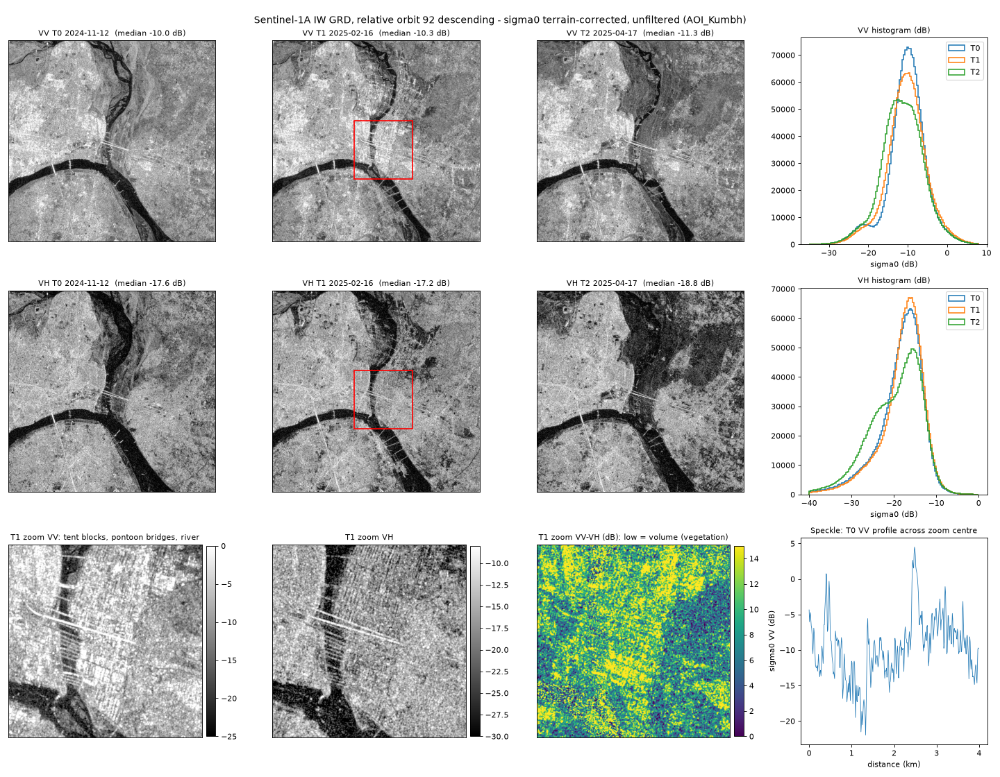
</details>

<details><summary><b>Phase 6 · Speckle filter evaluation</b></summary>

Boxcar, Median, Lee, Refined Lee, Lee Sigma, Frost, Gamma-MAP, Kuan, IDAN, MuLoG, multi-temporal Quegan and SAR2SAR, each at 3×3, 5×5 and 7×7 where applicable. Metrics: ENL, SSI, MR, SMPI, EPI and point-target preservation. [`06_Speckle_Filter_Evaluation.md`](09_docs/06_Speckle_Filter_Evaluation.md)
</details>

<details><summary><b>Phase 7 · Sentinel-2 processing</b></summary>

SCL mask (classes 0, 1, 3, 8, 9, 10), reflectance = (DN − 1000) / 10000, 20 m → 10 m bilinear resampling, stacks, natural / false-colour / SWIR composites, stretches and indices. [`07_EO_Processing.md`](09_docs/07_EO_Processing.md)

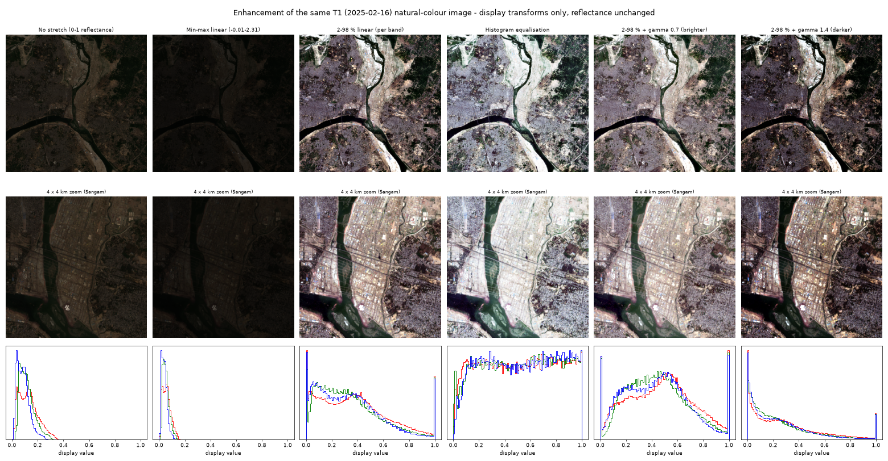
</details>

<details><summary><b>Phase 8 · Georeferencing and co-registration</b></summary>

GCP polynomial (orders 1 and 2) and thin plate spline with independent check points; absolute checks against OSM bridges; phase correlation between dates; AROSICS; same-day water-mask matching between S1 and S2. [`08_Georeferencing_Coregistration.md`](09_docs/08_Georeferencing_Coregistration.md)
</details>

<details><summary><b>Phase 9 · Fusion</b></summary>

Lossless 11-band stack per epoch (S1 VV, VH, VV−VH + 6 S2 bands + 2 indices; Float32 with DEFLATE), PCA, IHS, Brovey, HPF and a multi-temporal SAR RGB (R = T1, G = T0, B = T2). [`09_Fusion.md`](09_docs/09_Fusion.md)
</details>

<details><summary><b>Phase 10 · Vector feature database</b></summary>

9-layer GeoPackage with one common schema (class, epoch, method, confidence, source, date). Styles are stored inside the GeoPackage. Validation found 0 invalid geometries, 0 NULLs in required fields and 0 tent-block overlaps. The tent city at T1 covers 12.3 km² in 51 blocks. Exports to SHP, GeoJSON, KML and CSV. [`10_Vector_Database.md`](09_docs/10_Vector_Database.md)

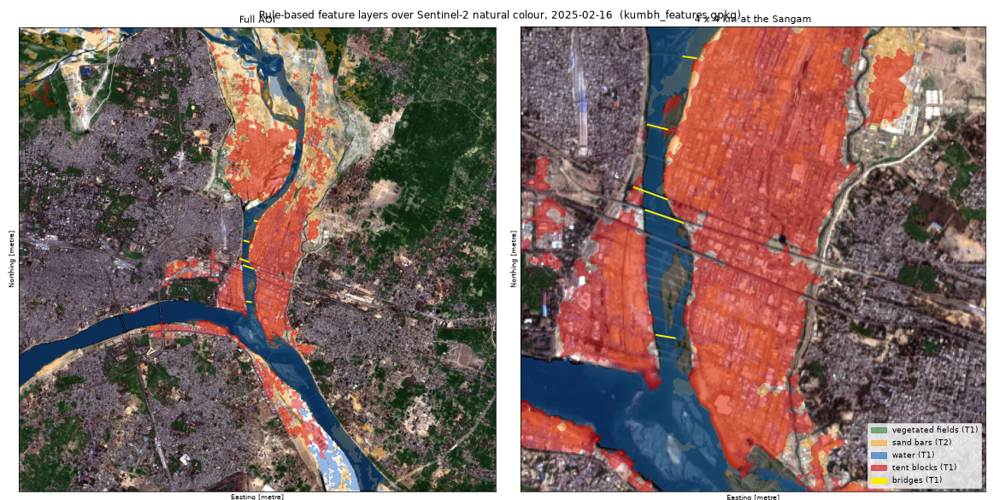
</details>

<details><summary><b>Phase 11 · QGIS plugin demonstrations</b></summary>

15 plugins, each demonstrated on the Kumbh data. Scripted where possible, with GUI steps documented. [`11_Plugin_Demos.md`](09_docs/11_Plugin_Demos.md)
</details>

<details><summary><b>Phase 12 · Signature reference sheet</b></summary>

VV, VH, VV−VH, NDVI, MNDWI and NDBI per class and epoch, plus Jeffries–Matusita separability. Sand training samples exclude ground within 30 m of tent blocks to avoid mixed pixels. [`12_Signature_Reference_Sheet.md`](09_docs/12_Signature_Reference_Sheet.md)

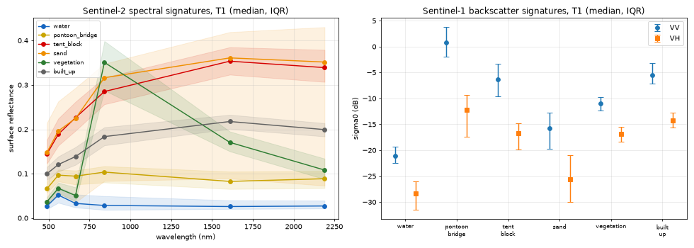
</details>

<details><summary><b>Phase 13 · Change detection and classification</b></summary>

Log-ratio change detection with a fixed (+3 dB) and an Otsu threshold (+1.97 dB build / −3.53 dB clear): 15.45 km² appeared, 34.75 km² vanished, 12.22 km² temporary. Random Forest with 5 classes on six input sets, validated on independent polygons. [`13_Change_Detection_Classification.md`](09_docs/13_Change_Detection_Classification.md)

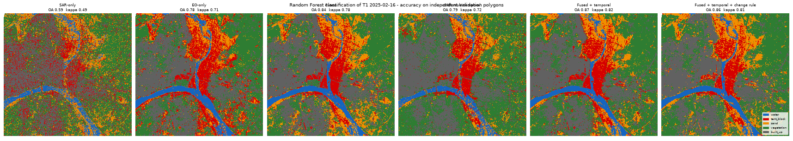
</details>

<details><summary><b>Phase 14 · AI comparison</b></summary>

SAR2SAR vs Lee, OmniCloudMask vs SCL (including monsoon scenes), and SAM vs rule-based tent digitising. [`14_AI_Comparison.md`](09_docs/14_AI_Comparison.md)
</details>

<details><summary><b>Phase 15 · Layouts, packaging and reopen test</b></summary>

7 A4 landscape layouts with title, map, legend, scale bar, north arrow, grid and credits. Relative paths throughout. The packaged project was extracted to a different folder and reopened: 47/47 layers valid and 7 layouts present (plugin demo project: 14/14 layers valid).
</details>

---

## ⚠️ Limitations

- **Resolution:** a single tent (about 4–6 m) is smaller than a 10 m pixel, so tent **blocks** are mapped, not individual tents.
- **No field ground truth:** validation uses independent polygons digitised from the imagery.
- **SAR ↔ optical registration:** AROSICS cannot match SAR to optical texture, so same-day water masks were used instead.
- **Empirical thresholds:** change results depend on soil moisture and wind; the fixed and Otsu thresholds give a range (8.7–11.5 km² at T1).
- **Sand class:** the weakest class (PA 0.55 / UA 0.54), because sand and water are both dark in SAR.
- **Pontoon bridges:** only 5 of about 30 were extracted automatically at 10 m; the rest need manual digitising.
- **Single orbit:** descending pass only.

## 🔭 Future work

- Very-high-resolution SAR (ICEYE, Capella, Umbra, EOS-04) to count individual tents.
- Deep tent detection (U-Net / Mask R-CNN) trained on SAM-assisted labels.
- Fine-tuning EO foundation models (TerraMind, Prithvi) on fused S1 + S2.
- InSAR coherence from SLC data as a backscatter-independent change signal.
- Deep SAR–optical matching for cross-sensor co-registration.

---

## ❓ FAQ

<details><summary><b>Why does the project open with missing raster layers?</b></summary>

The GeoTIFFs are not in git (≈ 1.2 GB). Regenerate them with the pipeline, or unzip the submission package over the cloned folder. The project uses relative paths, so the layers reconnect automatically.
</details>

<details><summary><b>Why Lee 7×7 and not the deep-learning SAR2SAR?</b></summary>

Lee 7×7 had the best combined rank: high ENL, no mean bias and good edges. SAR2SAR preserved edges better but was 3× slower and gave a very low ENL over water. Lee is also predictable and fully documented.
</details>

<details><summary><b>Why UTM 44N (EPSG:32644)?</b></summary>

Prayagraj (≈ 81.9° E) lies in UTM zone 44. Metre units make areas, buffers and RMSE meaningful, and Sentinel-2 tile 44RNP is natively in this zone, so it needs no reprojection.
</details>

<details><summary><b>Why do the tent areas differ between methods?</b></summary>

Each method measures something slightly different. The log-ratio rule counts pixels that brightened strongly since November. The Random Forest counts every pixel that looks tent-like at T1, including mixed pixels at block edges. Reporting both gives an honest range.
</details>

<details><summary><b>Can I run this for another event or area?</b></summary>

Yes. Change the AOI in `make_aoi.py` and the dates and product IDs in `download_manifest.csv`, then rerun the pipeline. Check the CRS and grid constants at the top of each script, and pick the UTM zone that fits the new area.
</details>

---

## 📖 References

<details>
<summary><b>Key references (click to expand)</b></summary>

1. Lee, J.S. (1980). Digital image enhancement and noise filtering by use of local statistics. *IEEE TPAMI*.
2. Frost, V.S. et al. (1982). A model for radar images and its application to adaptive digital filtering of multiplicative noise. *IEEE TPAMI*.
3. Kuan, D.T. et al. (1985). Adaptive noise smoothing filter for images with signal-dependent noise. *IEEE TPAMI*.
4. Lopes, A., Touzi, R., Nezry, E. (1990). Adaptive speckle filters and scene heterogeneity. *IEEE TGRS*.
5. Lee, J.S. et al. (2009). Improved sigma filter for speckle filtering of SAR imagery. *IEEE TGRS*.
6. Quegan, S., Yu, J.J. (2001). Filtering of multichannel SAR images. *IEEE TGRS*.
7. Pohl, C., van Genderen, J.L. (1998). Multisensor image fusion in remote sensing. *IJRS*.
8. Scheffler, D. et al. (2017). AROSICS: an automated and robust open-source image co-registration software. *Remote Sensing*.
9. Filipponi, F. (2019). Sentinel-1 GRD preprocessing workflow. *Proceedings (MDPI)*.
10. Spröhnle, K. et al. (2017). Object-based analysis and fusion of optical and SAR satellite data for dwelling detection in refugee camps. *IEEE JSTARS* 10(5).
11. Braun, A. et al. (2019). Refugee camp monitoring and environmental change assessment of Kutupalong, Bangladesh, based on radar imagery of Sentinel-1 and ALOS-2. *Remote Sensing* 11(17).
12. Dalsasso, E., Denis, L., Tupin, F. (2021). SAR2SAR: a semi-supervised despeckling algorithm for SAR images. *IEEE JSTARS* 14.
13. Fracastoro, G. et al. (2021). Deep learning methods for SAR image despeckling: trends and perspectives.
14. OmniCloudMask (2025). *Remote Sensing of Environment*, doi 10.1016/j.rse.2025.114694.
15. Meraner, A. et al. (2020). Cloud removal in Sentinel-2 imagery using a deep residual neural network and SAR-optical data fusion. *ISPRS J.*
16. Kirillov, A. et al. (2023). Segment Anything. *ICCV*.
17. TerraMind: large-scale generative multimodality for Earth observation (2025). arXiv 2504.11171.

The full list is in [`02_Literature_Survey.md`](09_docs/02_Literature_Survey.md).

</details>

---

## 📄 License and author

Released under the [MIT License](LICENSE). Sentinel data © Copernicus / ESA (free and open). OSM data © OpenStreetMap contributors (ODbL).

**Priyadarshini R** — internship selection project, 2026 · GitHub: [@priyadarshinir2228](https://github.com/priyadarshinir2228)

<div align="center"><sub>⭐ If you find this useful, consider starring the repository.</sub></div>
